<p align="center">
  <picture>
    <source media="(prefers-color-scheme: dark)" srcset="docs/brand/dark_logo@2x.png">
    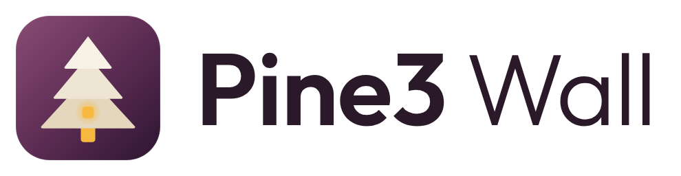
  </picture>
</p>

<p align="center"><b>English</b> · <a href="README.pt.md">Português</a></p>

**Pine3 Wall** turns a tablet on the wall into the control panel of your home. It has three parts that share one model of the house:

| Part | What it does |
|---|---|
| **Home Assistant integration** (`pine3_wall`) | Builds the house from your areas, devices and entities (no YAML), keeps the people, layouts, family calendar and chores, and registers each wall tablet as a Home Assistant device you can automate. |
| **Web editor and panel** (Home Assistant sidebar) | Designs what the tablets show (pages, sections, cards, dock, ambient screens) and is also a full panel in the browser or on a phone, with the same views as the tablets. |
| **Native Android app** (`pt.pine3.wall`) | The panel on the tablet, without a WebView: wakes up with motion, turns the screen off, plays the video screensaver, opens the doorbell and draws everything natively and smoothly. |

> **Tested on an OPPO Pad SE (11", ColorOS) mounted on the wall.** Other Android tablets should work, but power management differs between
> brands (see [Setting up the tablet](#setting-up-the-tablet)).

Pine3 Wall is the successor of [Pine3 View](https://github.com/pinheirofilipem-ux/pine3-view). It uses another domain, panel address,
storage and app id, so both can be installed side by side while you move over.

## Contents
- [Screenshots](#screenshots)
- [Install](#install)
- [Setting up the tablet](#setting-up-the-tablet)
- [The home](#the-home)
- [Layout editor](#layout-editor)
- [Modules: ambient screens, family calendar, chores and the family's day](#modules)
- [The wall tablet (Android app)](#the-wall-tablet-android-app)
- [Tablets in Home Assistant](#tablets-in-home-assistant)
- [The web panel](#the-web-panel)
- [Settings](#settings)
- [How it works](#how-it-works)
- [Development](#development)

## Screenshots
The web panel and the app look the same; these were taken in the web panel with a sample home.

| Home (Big clock) | Home (Two columns, vivid Amber background) |
|---|---|
| 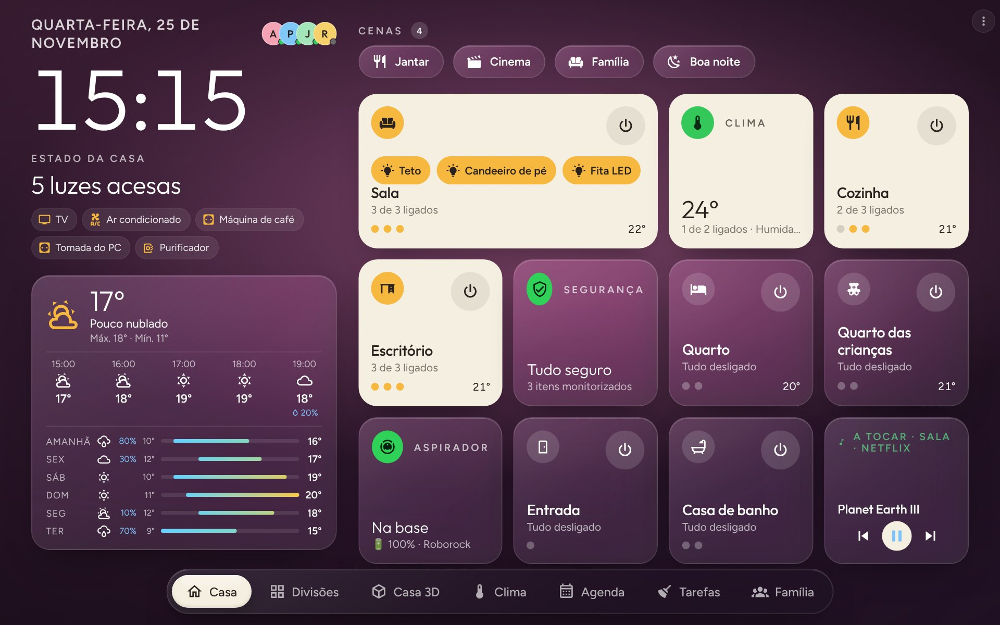 |  |
| **Home (light background)** | **Room** |
| 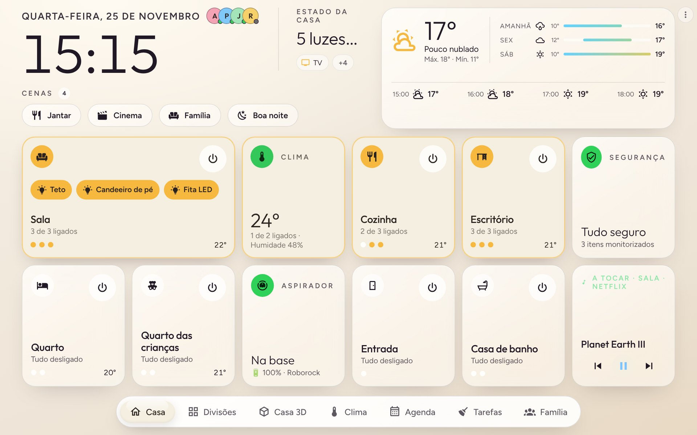 | 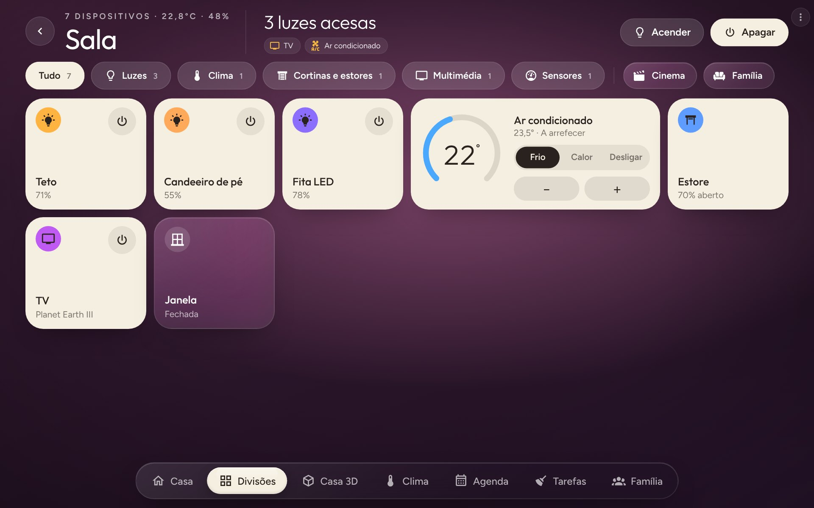 |
| **Weather forecast and IPMA warnings** | **Climate screen** |
| 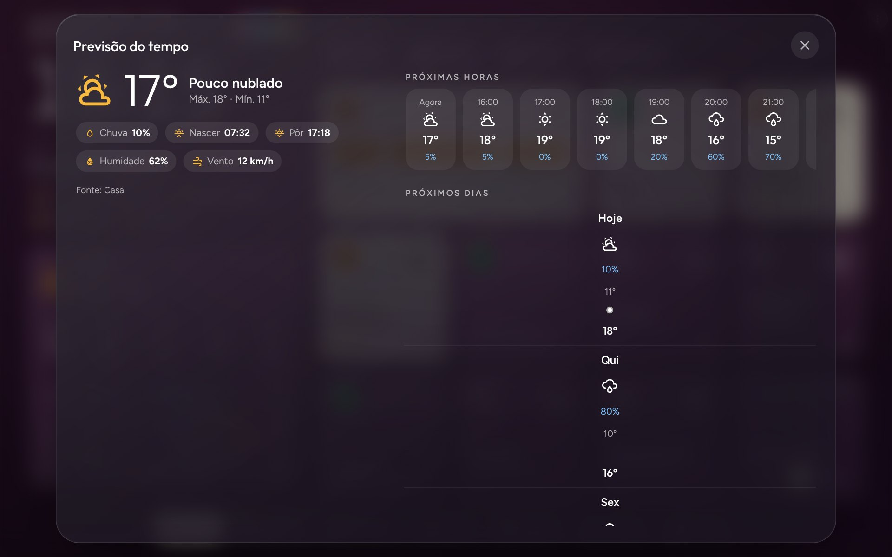 | 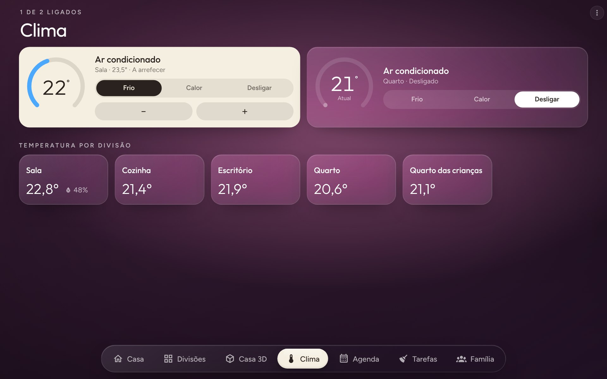 |
| **Air conditioner** | **Robot vacuum** |
| 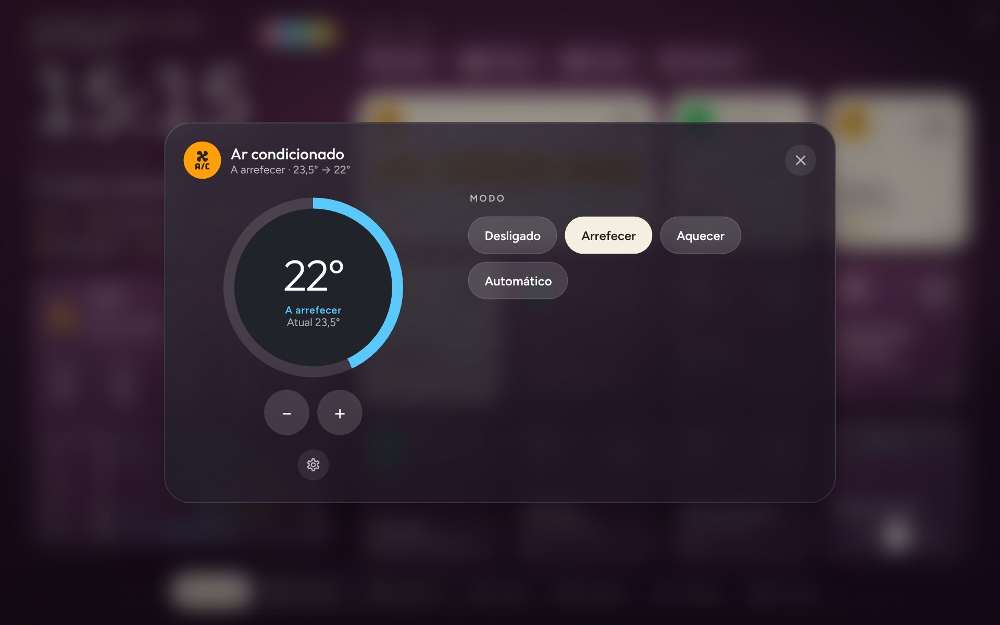 | 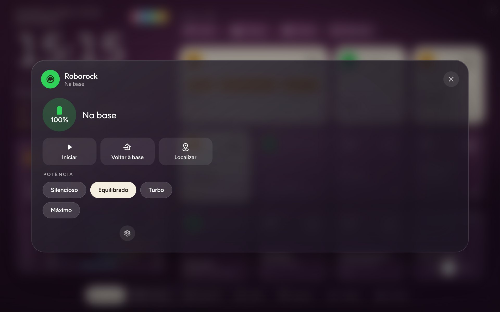 |
| **3D Home** | **Floor plan: devices** |
| 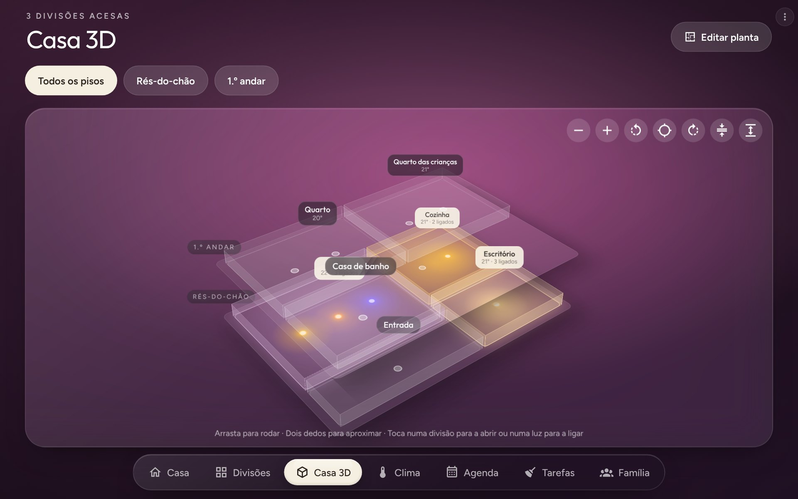 |  |
| **Edit mode** | **Settings: appearance** |
| 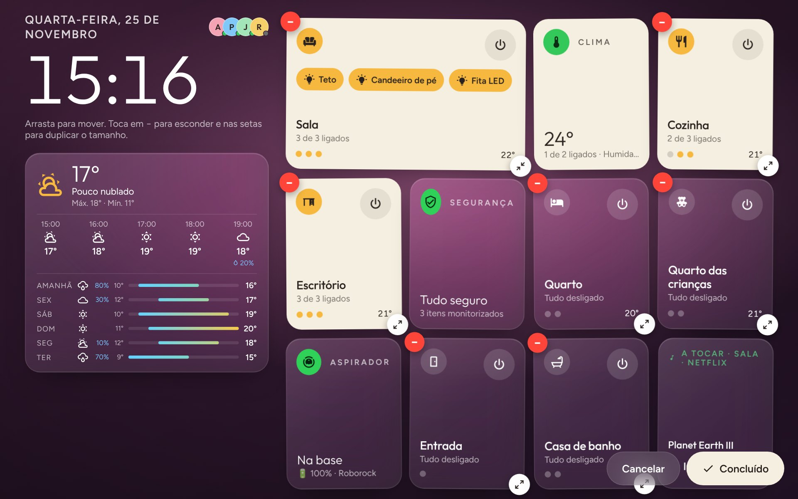 | 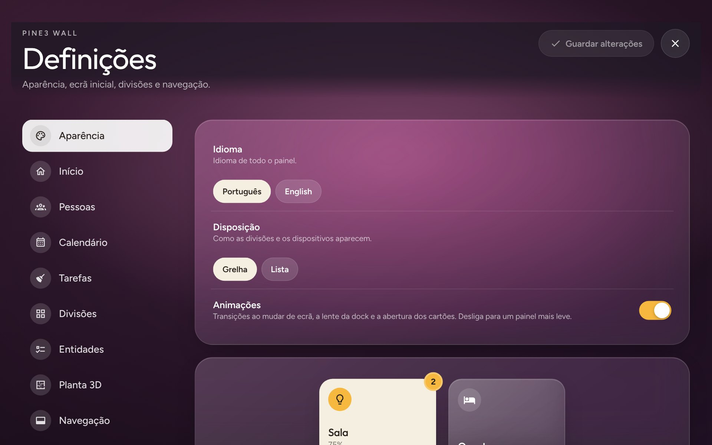 |

On a phone:

| Home | Light | 3D Home |
|---|---|---|
| 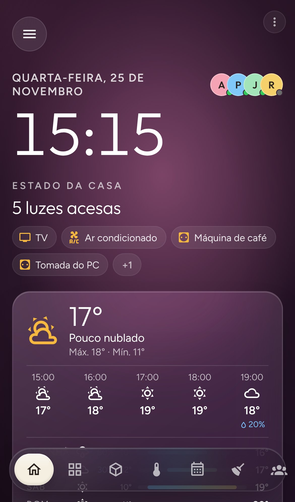 | 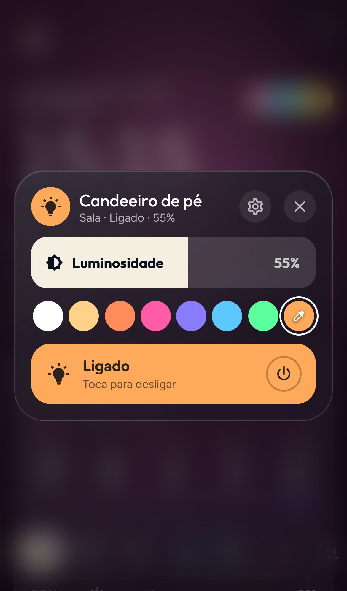 |  |

## Install

### 1. The integration (HACS)
1. In Home Assistant open **HACS** → **⋮** → **Custom repositories**.
2. Repository `https://github.com/pinheirofilipem-ux/pine3-wall`, type **Integration** → **Add**.
3. Search for **Pine3 Wall**, **Download**, and restart Home Assistant.
4. **Settings → Devices & services → Add integration → Pine3 Wall**.
5. **Pine3 Wall** appears in the sidebar.

Requires Home Assistant 2024.7 or newer. To update, download the new version in HACS and restart; the browser picks up the new files by itself.
Manual install: copy `custom_components/pine3_wall` to `/config/custom_components/`, restart and add the integration.

### 2. The app
1. Download `Pine3Wall-X.Y.Z.apk` from the [Releases](https://github.com/pinheirofilipem-ux/pine3-wall/releases) (same version as the integration)
   and install it on the tablet.
2. In Home Assistant, create a **long-lived access token** (your profile → Security).
3. Open the app: enter the Home Assistant address (an IP like `http://192.168.1.10:8123` is safer than `.local` on Android) and the token.
   **Test connection** checks DNS, the websocket, the token and the integration step by step.
4. In the app's settings → **Permissions**, grant everything until it is all green: camera (motion), device administrator (turn the
   screen off completely), no battery optimisation, and display over other apps (start on boot).

The app and the integration share one version number; the app warns when one of them is too old for the other.

## Setting up the tablet
Android brands kill background apps in different ways. On the tested **OPPO Pad SE (ColorOS)**:
- **App settings → Battery**: *Allow background activity*, *Allow auto launch* on; battery use **unrestricted**.
- **App settings → Permissions**: turn off *Remove permissions if the app isn't used*. Keep the app's notifications on (the motion service
  needs its notification to stay alive).
- **Battery**: power saving off; *Optimise battery use* / *sleep standby optimisation* off.
- **Recents**: lock the app (padlock) so it isn't cleared; screen pinning works too.
- **Screen lock**: *None* or *Swipe* is the most reliable (the app shows over the lock screen, but with a PIN some versions wake to the lock screen).
- **Display → Auto screen off**: the longest value; the app turns the screen off itself.
- If the old Pine3 View app is still installed, stop it: only one app can use the front camera for motion.

Then restart the tablet. The app must start by itself, and the tablet's *Online* entity in Home Assistant must stay on overnight.

## The home
Everything is built automatically from Home Assistant and kept up to date when you add or move devices.

- **Home screen** in four templates: **Big clock**, **Two columns**, **Sidebar** or **Classic**, with date, people at home, home status
  (lights and what else is on), weather, scenes and one grid of cards. On the tablet the cards are all the same height and reach the dock.
- **Rooms** from your areas (ordered by floor), with a power button for the lights, what is on, temperature and humidity; a **room screen**
  with category chips (Lights, Climate, Covers, Media…) and one grid of cards.
- **Devices** as cards driven by their main entity; the device's other entities (power, battery, filters…) come along.
  - **Lights, TVs, plugs and switches** open a **compact sheet**: brightness, colours (with a free colour picker), media controls, the
    device's readings and a big on/off button. ⚙ opens the whole device (settings and diagnostics).
  - **Climate** (Tado, HomeKit, AC units…): target ring, heat/cool range, modes, fan, swing and presets; a **Climate screen** with every unit.
  - **Robot vacuum** (Roborock): status, battery, **routines**, start/pause/dock/locate, suction, **clean chosen rooms** (`roborock.get_maps`),
    the map and the everyday controls; a wide card in its room with "clean this room".
  - **Cameras**: the last picture only (never streams on its own); live video on tap with the doors beside it ("choose doors").
  - **Locks** need two taps to unlock. **Covers**, fans, purifiers, media players, Apple TV and HomePod have their own cards.
- **Summary cards**: Climate, Security (doors, windows, locks), Vacuum and Now playing.
- **Doorbell** (`event` entities of class doorbell, e.g. Comelit Intercom): a pop-up with the door camera's last picture, the call's own
  picture as soon as it arrives, **Open door** (two taps) and **View camera**; on the tablet it wakes the screen.
- **Weather** from a Home Assistant weather entity or [Open-Meteo](https://open-meteo.com): now, the next hours (scroll sideways), 7 days,
  UV, fire risk and **IPMA warnings** (Portugal).
- **3D Home**: rooms stacked by floor, lit in the colour of their lights; rotate, zoom, tap a light or open a room. A **floor-plan editor**
  (web) draws rooms in any shape and places every device.
- **Scenes** stay highlighted while their devices are on; tap again to turn them off.
- **Edit mode** (✎ on the web, ⋮ on the tablet): drag to reorder, hide, double size.

## Layout editor
*Settings → Layout → Open the editor* in the web panel. What you build here is what the tablets draw.

- **Pages**: Home, Rooms, 3D Home, Scenes, Climate, Security, Agenda, Chores, Family, every room and your **ambient screens**.
- **Sections** (clock, people, status, weather, scenes, grid…) and **cards** (rooms, devices, summaries, *Coming up*, *Today's chores*),
  dragged into order, double size, added or removed; the home template; the **dock** (which views and in what order); grid or list,
  24-hour clock and animations.
- **Draft, Publish and History**: work on a draft, publish when ready, go back to an earlier version or to the automatic layout.
- **Draft on the tablets**: shows the draft live on every tablet while you edit, without publishing.
- **Variants**: besides the main layout you can create others (e.g. "Bedrooms") and choose, per tablet, which one it uses.

Without a published layout, the layout is made automatically from the settings, so nothing changes until you publish one.

## Modules

### Ambient screens
Composed screens to look at from afar (like StandBy): **1 to 3 faces side by side**: analog clock (classic, minimal, bold), digital
clock, date, weather, a sensor in big type, who is home, **next event**, **today's agenda**, **today's chores** and **the family's day**,
with an accent colour and a dim red **night mode**. An ambient screen can be a page in the dock (tablet and web) and the tablet's
**screensaver** (app settings → Screensaver → Ambient screen).

### Family calendar
One shared calendar for the family, for example a **"Família" calendar in iCloud** connected with Home Assistant's **CalDAV** integration
(server `https://caldav.icloud.com`, your Apple ID and an app-specific password); Google, Outlook or the local calendar work too.
- *Settings → Calendar*: which calendars to read, those shown only as **Busy**, days ahead and the family colour.
- **Whose an event is** comes from its title: `[Pedro] Swimming`, `Pedro: Swimming`, `Pedro and Ana: Dinner` or `Swimming [Pedro]`
  (name or short name from *Settings → People*); no name means the whole family. The settings preview whose a title would be.
- **Agenda** page: **Day** with a column per person and one for the family, **Week** and **Month**; tap an event for its time, place and people.
- *Coming up* card (everyone's or one person's) and the *Next event* / *Today's agenda* faces.

### Chores
Who does what on each day of the week: only the list of what was agreed, there is no "done".
- *Settings → Chores*: the chores (name, icon, time of day) and a weekly grid where you tap who does each one on each day.
- **Chores** page (today by person and the whole week), *Today's chores* card and face; the chore of the current time of day is highlighted.
- A **sensor per person** in Home Assistant (*House chores* device) with the number of chores today and the list in its attributes, for
  automations and notifications.

### The family's day
A **Family** page with a column per person holding their events and chores of today or tomorrow in time order (the current chore highlighted,
past events dimmed), plus the whole family's events, and an ambient face with one line per person.

### People
*Settings → People*: the family comes from Home Assistant's `person.*`; choose each person's colour, short name and whether they show.
The calendar, chores, home screen and ambient faces all use them.

## The wall tablet (Android app)
- **Motion wakes the screen** (front camera, adjustable sensitivity) and the app **turns it off completely** after a while (device
  administrator), fading to black and back.
- **Screensaver** before the screen turns off (entry and lock times in seconds):
  - **Classic**: a dimmed drifting clock.
  - **Video**: full-screen clips with the time and date, fades between clips, fit and quality; clips from **one or more folders on the
    tablet**, a zip pack, a list of addresses or the Apple TV aerials, with a per-clip switch. 4K HEVC that the normal player refuses
    plays through MediaCodec. Videos stay on the tablet.
  - **Ambient screen** from the layout editor.
- **Doorbell wakes the screen** and opens the pop-up; the services below wake it too.
- **Swipe left/right** to go to the next/previous view of the dock.
- **Liquid Glass** dock (the lens slides and stretches like a drop, and can be dragged), elastic animations, 26 themes, three glass styles,
  Portuguese and English, interface scale.
- Every Material Design icon (the same as Home Assistant), and settings in the same format as the web panel plus an **App** section
  (connection, interface size, doorbell test, start on boot, permissions).
- Starts by itself after a reboot; reconnects by itself and stays connected with the screen off.
- Shortcut to the settings: hold two fingers for 2 s, or the ⋮ menu.

More detail (build, signing, releases) in [android/README.md](android/README.md).

## Tablets in Home Assistant
Each tablet that connects appears as a **device "Pine3 Wall &lt;name&gt;"** with: *Online*, *Motion* (front camera), *Screen*,
*Battery*, *Screen brightness*, *Page* and a **Wake** button. Rename it, choose its layout (main or a variant) or remove it in
*Settings → Tablets* in the web panel, which also has **Wake** and **Test message** buttons.

Services for automations (target one or more tablets; no target = all of them):

| Service | What it does |
|---|---|
| `pine3_wall.wake` | Turns the screen on (and keeps it on for `seconds`). |
| `pine3_wall.show_page` | Opens a page: `home`, `rooms`, `calendar`, `chores`, `family`, `room/<area>`, `ambient/<id>`… |
| `pine3_wall.show_camera` | Opens a camera's live video. |
| `pine3_wall.notify` | Shows a message on the screen ("Dinner is ready"), waking it. |
| `pine3_wall.screensaver` | Turns the screensaver on or off. |

## The web panel
The same panel as the tablets, in any browser or on a phone:
- With a **published layout** it shows exactly what the tablets show: home template and sections, the order, size and kind of every
  card, each room's devices and the dock with its ambient screens.
- **Phone**: one column, the agenda and the family's day as a list, swipe between views.
- **Full screen** (*Settings → Home → This device*) and **kiosk mode**: add `?kiosk` to the address
  (`http://homeassistant.local:8123/pine3-wall?kiosk`) to hide the Home Assistant sidebar.
- Per-device options (stay in that browser): sidebar, keep the screen on, 3D view quality (full, light, picture or 2D plan), light effects, animations, doorbell pop-up.

## Settings
In the web panel (⋮ → Settings) or the app. Stored in Home Assistant, so they apply to every tablet and browser:
**Appearance** (language, grid or list, card and highlight colours, 26 backgrounds, automatic day/night), **Home** (template, sections,
weather source, screensaver), **People**, **Calendar**, **Chores**, **Rooms** (order, hidden, size in the 3D home), **Entities** (exactly
what appears), **3D floor plan**, **Navigation** (dock), **Layout** (the editor), **Tablets** and **System**.

## How it works
- **The house** (`discovery.py`) is built from Home Assistant's registries: areas → rooms (ordered by floor), devices → cards driven by
  their main entity, multi-channel relays split, room names removed from device names, hidden/diagnostic/configuration entities left out.
- **The contract** between the integration and the app lives in [`schema/`](schema/): the home model, the layout document, the catalogue
  of modules, cards and faces, the design tokens (themes and colours, generated for both Kotlin and CSS) and example payloads tested on
  both sides. A card type a tablet doesn't know shows "Update the app" instead of breaking.
- **One version** (`VERSION`) for the integration and the app; releases are tagged `vX.Y.Z` and carry the APK.

## Development
```bash
pip install -r requirements_test.txt
pytest
```
```bash
cd android
./gradlew :app:testReleaseUnitTest :app:assembleRelease
```
CI runs hassfest, the HACS check, pytest, the Kotlin tests and builds the signed APK. The plan and its phases are in [PLANO.md](PLANO.md)
(Portuguese). Next: pairing by QR code, an in-app update notice, kiosk as device owner and importing settings from Pine3 View.

Typefaces: [Outfit](https://github.com/Outfitio/Outfit-Fonts) and [Figtree](https://github.com/erikdkennedy/figtree) (SIL OFL 1.1).
Icons: [Material Design Icons](https://pictogrammers.com/library/mdi/) (Apache 2.0).

## License
MIT (see `LICENSE`). The fonts are under the SIL Open Font License 1.1 (see `NOTICE`).
